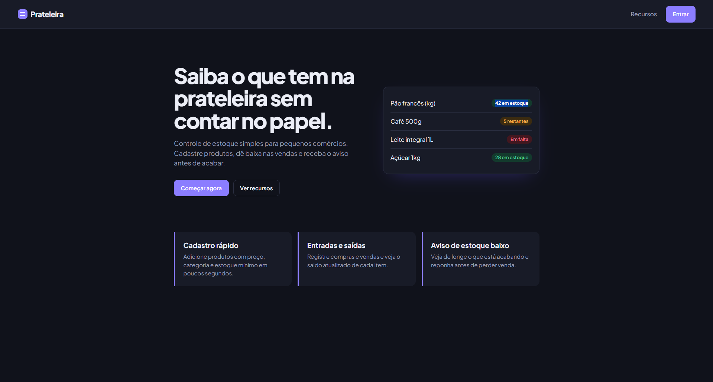
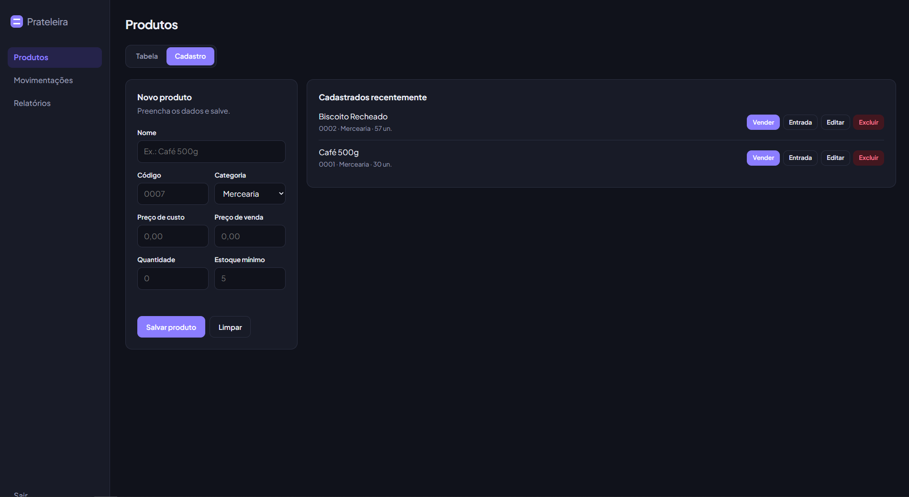
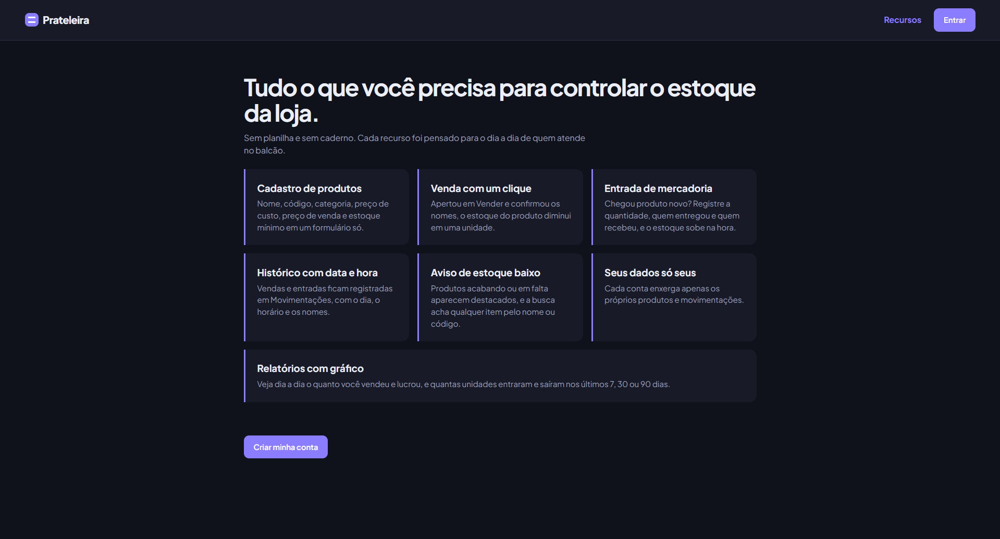
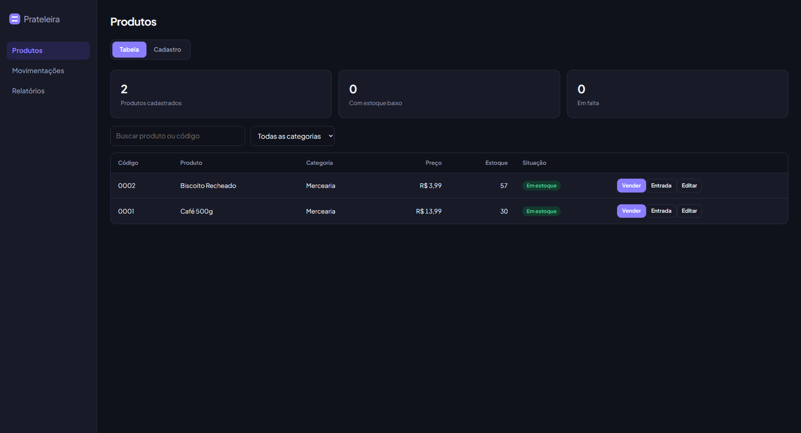
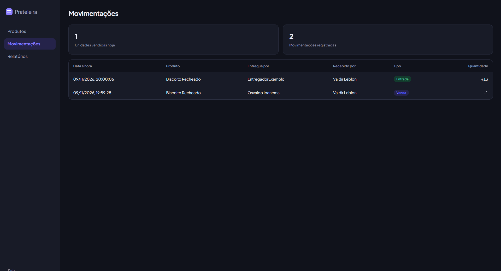
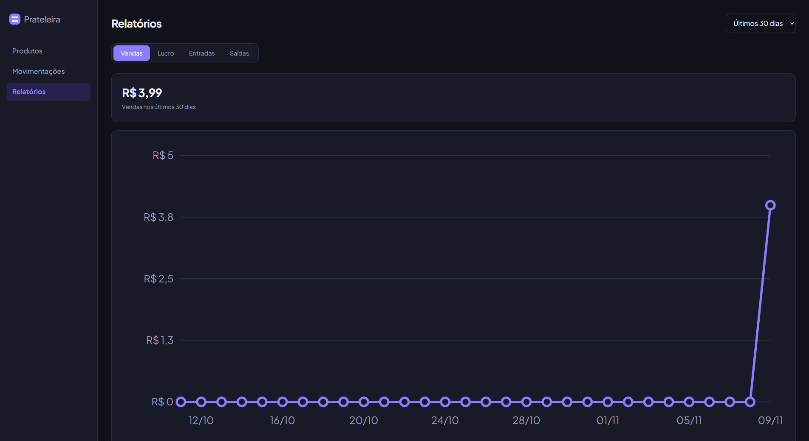

# 📦 Prateleira

Sistema web de gerenciamento de estoque desenvolvido para pequenos comércios. Permite cadastrar produtos, controlar entradas e saídas, registrar vendas e acompanhar indicadores de desempenho.


## 📸 Demonstração do sistema

### Página inicial


### Cadastro de usuário


### Login


### Recursos do sistema


### Gerenciamento de produtos


### Histórico de movimentações


### Relatórios



## 🚀 Funcionalidades

- **Autenticação:** cadastro e login de usuários.
- **Controle de estoque:** cadastro, edição, exclusão e consulta de produtos.
- **Vendas:** registro de vendas com atualização automática do estoque.
- **Entradas:** registro de reposição de mercadorias.
- **Histórico:** acompanhamento de movimentações com data, hora e responsáveis.
- **Relatórios:** gráficos de vendas, lucro, entradas e saídas.
- **Multiusuário:** cada conta possui acesso exclusivo aos próprios dados.
- **Interface responsiva:** adaptação para computadores e dispositivos móveis.

## 🛠️ Tecnologias

| Tecnologia | Utilização                            |
| ---------- | --------------------------------------- |
| Python 3   | Back-end                                |
| Flask      | Framework web                           |
| SQLite     | Banco de dados                          |
| HTML5      | Estrutura das páginas                  |
| CSS3       | Estilização e responsividade          |
| JavaScript | Interatividade e integração com a API |
| SVG        | Construção dos gráficos              |

## 📁 Estrutura do projeto

```text
prateleira/
├── app.py
├── requirements.txt
├── estoque.db
└── public/
    ├── index.html
    ├── recursos.html
    ├── login.html
    ├── cadastro.html
    ├── app.html
    ├── movimentacoes.html
    ├── relatorios.html
    └── style.css
```

## 🗄️ Banco de dados

O projeto utiliza SQLite, com três tabelas principais:

- **usuarios:** armazenamento de contas e senhas protegidas por hash.
- **produtos:** cadastro e controle de estoque.
- **movimentacoes:** histórico de vendas e entradas de mercadorias.

O banco é inicializado automaticamente pelo sistema.

## 🔒 Segurança

O sistema implementa:

- Senhas armazenadas com hash.
- Sessões autenticadas por cookies assinados.
- Isolamento de dados entre usuários.
- Consultas SQL parametrizadas.
- Validação de dados no servidor.
- Proteção contra XSS por escape de conteúdo.

## ⚙️ Instalação

1. Clone o repositório:

```bash
git clone <URL_DO_REPOSITORIO>
```

2. Entre na pasta do projeto:

```bash
cd prateleira
```

3. Instale as dependências:

```bash
pip install -r requirements.txt
```

4. Configure a variável de ambiente `SECRET_KEY` antes de utilizar o sistema em produção.

## 📌 Melhorias futuras

- Migração do SQLite para PostgreSQL.
- Implementação de recuperação de senha.
- Cadastro de funcionários e fornecedores.
- Proteção contra CSRF e limitação de tentativas de login.
- Implementação de backups automáticos.
- Expansão dos relatórios e funcionalidades comerciais.

---

**Prateleira** — Organização e controle de estoque de forma simples e eficiente.
